<h1 align="center">Atelier</h1>

<b>PC-first windows for FINAL FANTASY XIV.</b> 
Mouse-and-keyboard replacements for the game's console-style windows, as a Dalamud plugin.

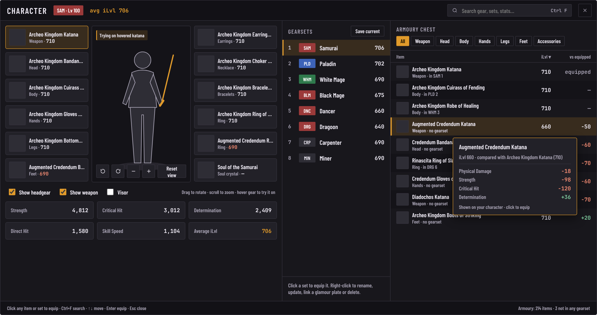

- **One click when one click is enough.** Join, Equip, Teleport, Buy, Summon, Apply plate: the main button finishes the job.
- **Nothing runs on its own.** No loops, no timers, no automation. One click does one thing.
- **Every window is a switch.** Turn any of them off in `/atelier` and the game's own window comes back.
- **Three skins** shared with HealFrames: Ledger, Heraldry and Signal.

## Install

1. In game, type `/xlsettings` and open the **Experimental** tab.
2. Under **Custom Plugin Repositories**, paste this link, click **+**, tick it as enabled, then **Save and Close**:

   `https://raw.githubusercontent.com/Gompex/atelier-releases/main/repo.json`

3. Type `/xlplugins`, open **All Plugins**, search for **Atelier** and click **Install**.
4. Type `/atelier`, switch on the windows you want, and press **Win+Space** anywhere (you can change the shortcut in `/atelier`).

New versions arrive like any other plugin update.

## What's inside

<table>
<tr>
<td width="50%" valign="top">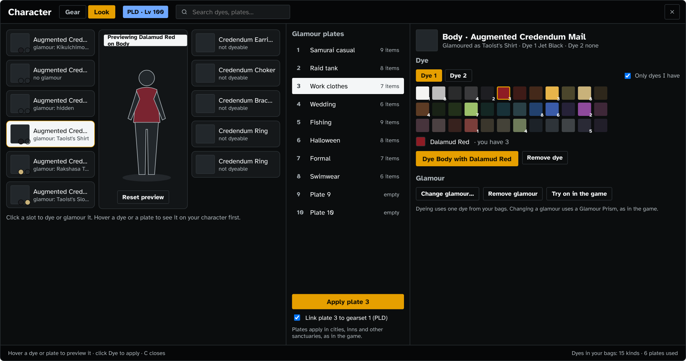 <b>Character → Look</b> Preview dyes and glamour plates on your character; apply a plate in one click.</td>
<td width="50%" valign="top">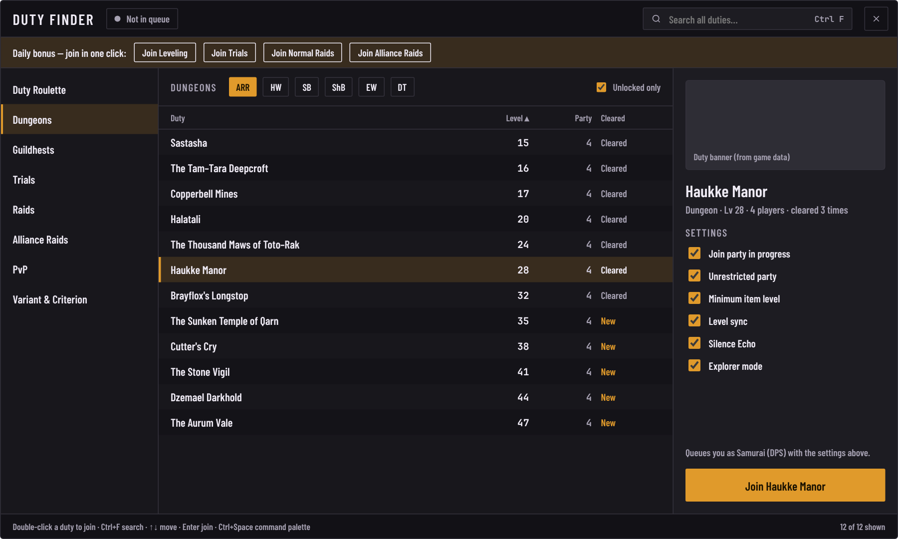 <b>Duty Finder</b> Every duty and roulette on one screen, with artwork, cleared state and one-click Join.</td>
</tr>
<tr>
<td width="50%" valign="top">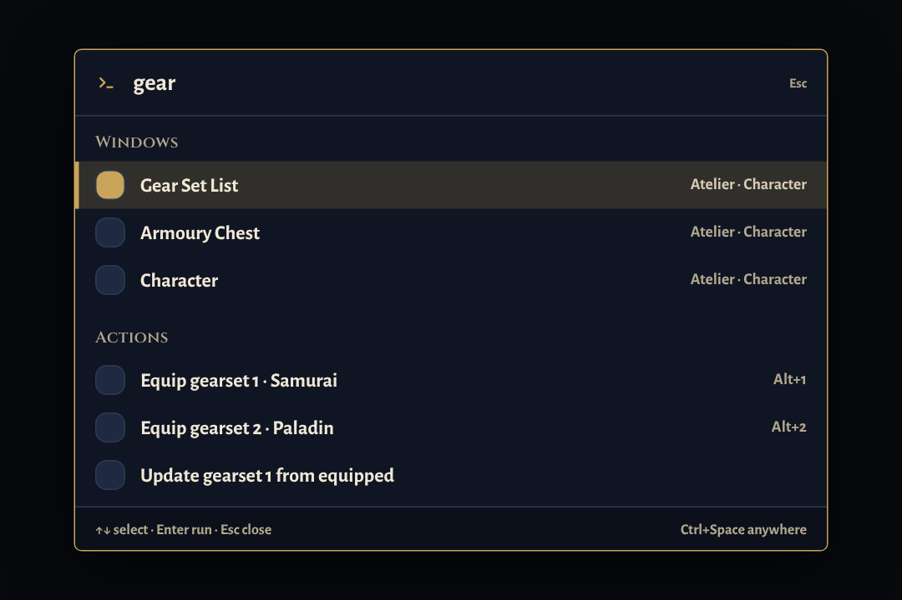 <b>Command palette (Win+Space)</b> Type to open a window, equip a gearset, teleport, summon a mount or join a duty.</td>
<td width="50%" valign="top">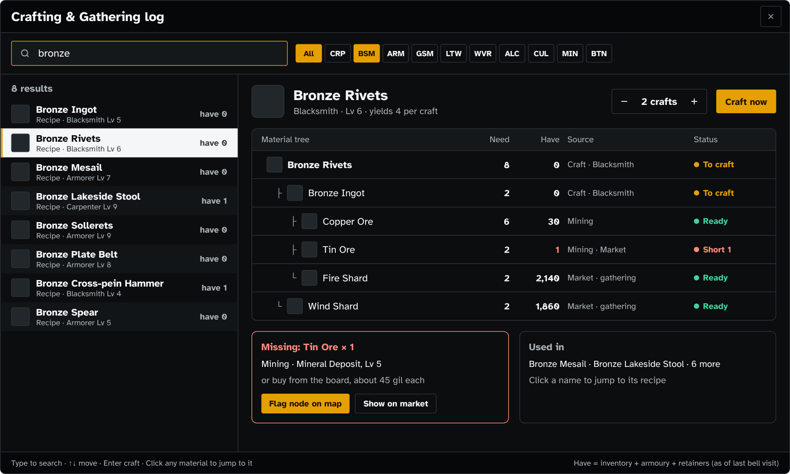 <b>Crafting &amp; Gathering log</b> Material trees with what you have, Craft now, and gathering spots on the map.</td>
</tr>
<tr>
<td width="50%" valign="top">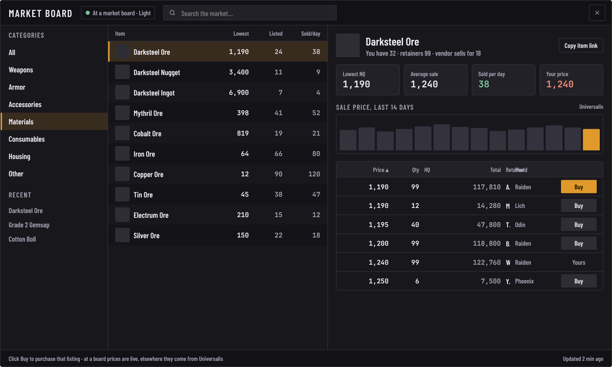 <b>Market Board</b> Search everything, see listings and recent sales, buy in one click.</td>
<td width="50%" valign="top">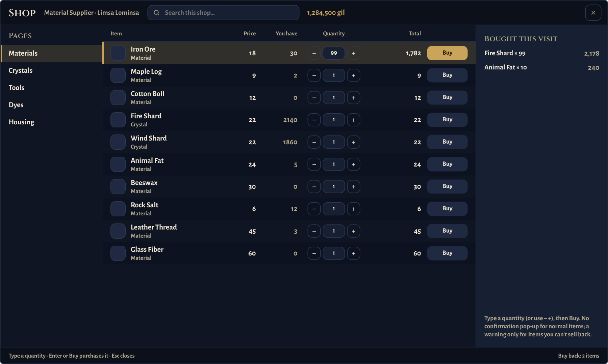 <b>Vendor shops</b> Type a quantity and Buy. Try gear on before you pay.</td>
</tr>
<tr>
<td width="50%" valign="top">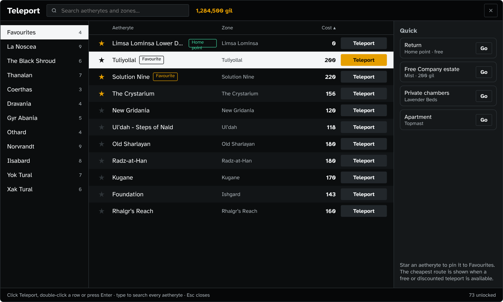 <b>Teleport</b> Every aetheryte with costs and favourites; one click teleports.</td>
<td width="50%" valign="top">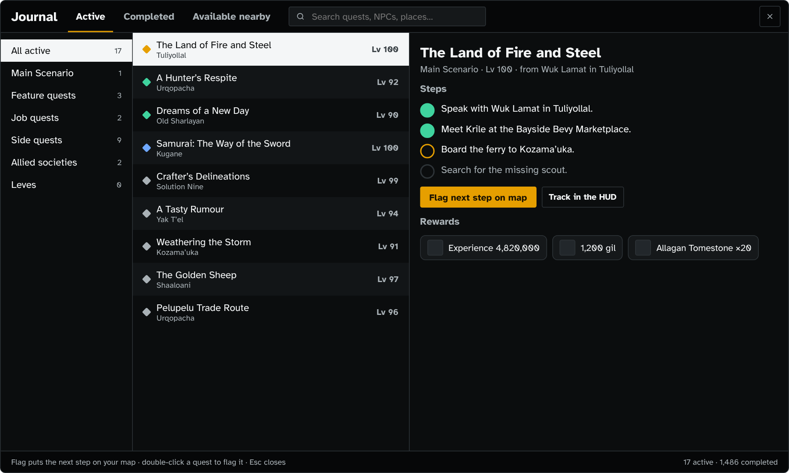 <b>Journal</b> Active, completed and nearby quests; flag the next step on your map.</td>
</tr>
<tr>
<td width="50%" valign="top">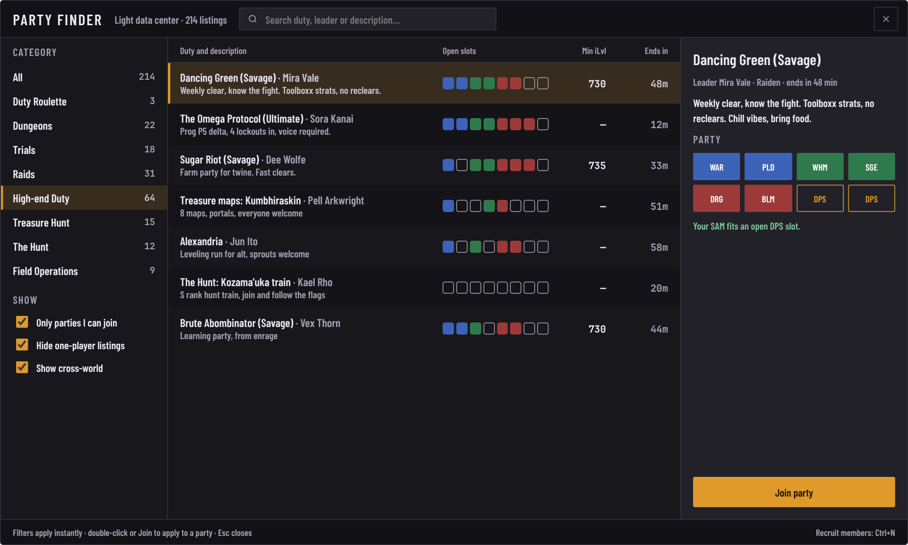 <b>Party Finder</b> Listings with role slots, filtered to parties you can actually join.</td>
<td width="50%" valign="top">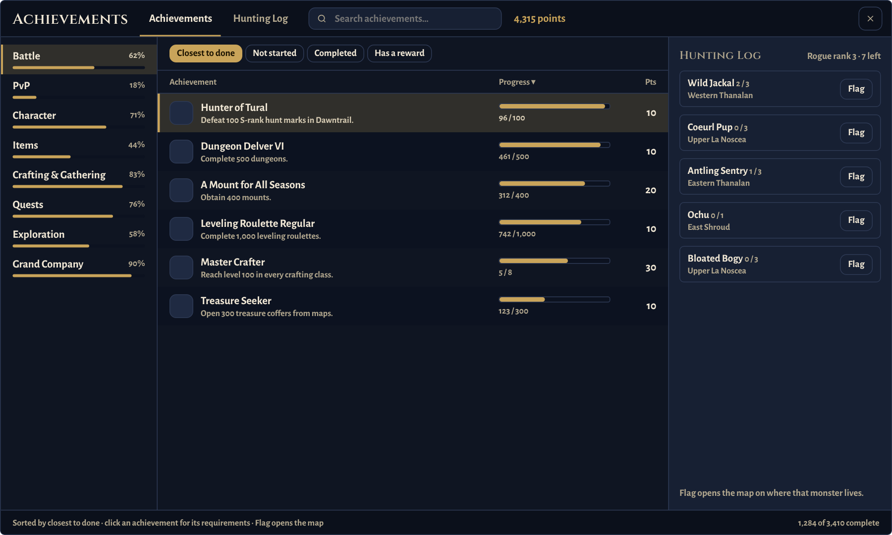 <b>Achievements &amp; Hunting Log</b> Progress, rewards, kill counts and zone maps.</td>
</tr>
<tr>
<td width="50%" valign="top">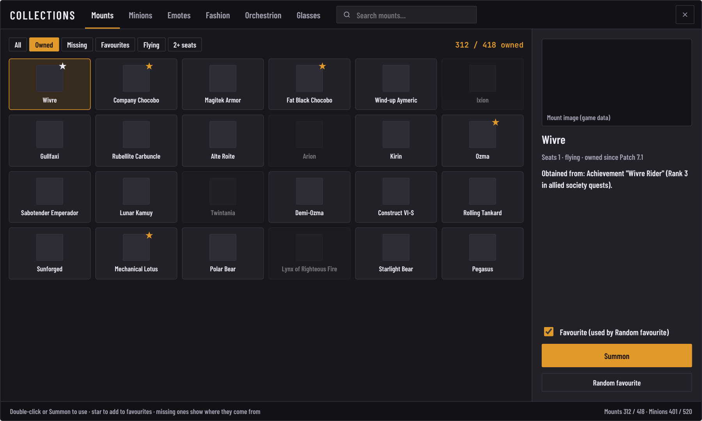 <b>Collections</b> Mounts, minions, fashion accessories and emotes; summon in one click.</td>
<td width="50%" valign="top">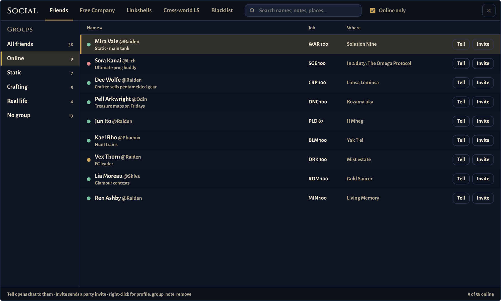 <b>Friends, FC and linkshells</b> Who's online, where they are, Tell and Invite.</td>
</tr>
<tr>
<td width="50%" valign="top">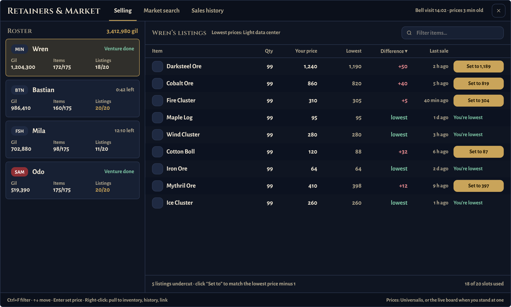 <b>Retainers</b> Every retainer and venture timer at a glance.</td>
<td width="50%"></td>
</tr>
</table>

Also: **Glamour Dresser** (search, filters, one-click Restore and Try On) and **recommended gear / gearset updates** in the Character window.

Pictures are design previews with sample data. In game, every name and number is your own.

## Skins

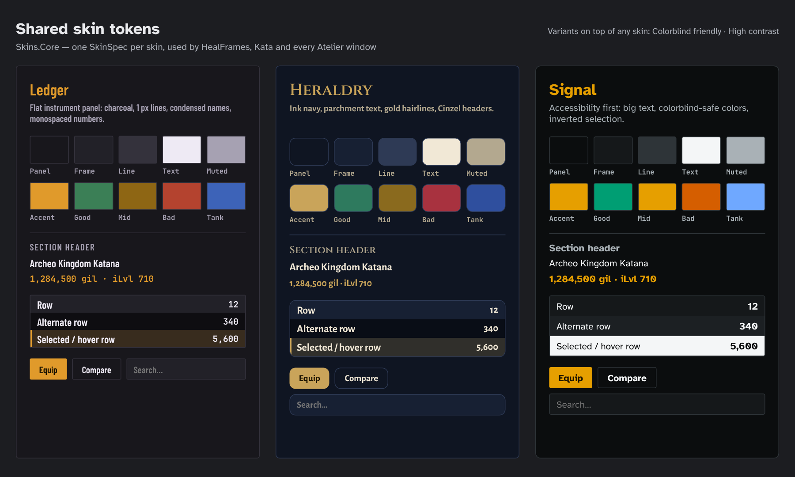

## Version

Current version: **0.11.0.0**

**What's new:** New windows: Teleport, Collections, Social, Vendor shop, Journal, Achievements & Hunting Log, Party Finder, Market Board. Character: Look tab (dyes, glamour, plates), recommended gear, gearset update/rename/save, reliable equipping. Duty Finder artwork banners.

This repository only holds the release zips and `repo.json` for Dalamud. The source is not here.